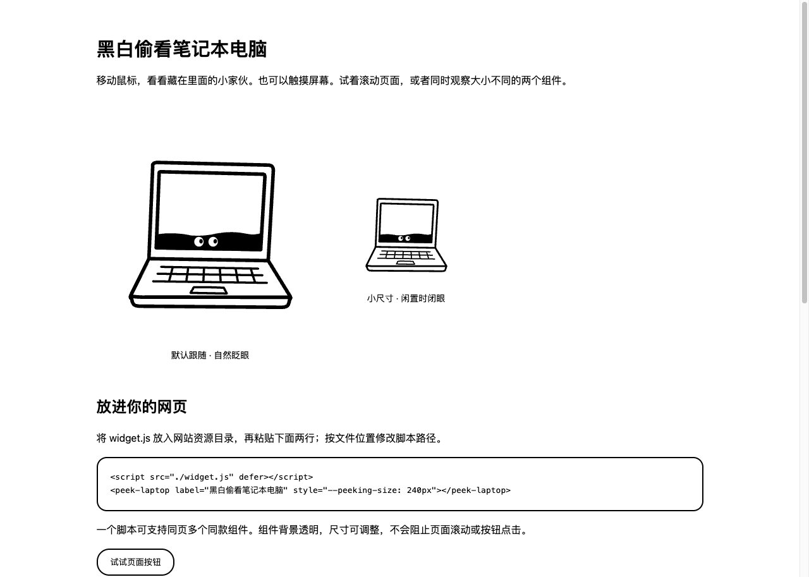

# Peepables

**Little things. Curious eyes.**

Peepables creates black-and-white doodle widgets with a pair of eyes peeking from inside everyday objects. The pupils follow your cursor, blink naturally, and stay inside their eye whites.

A reusable Codex skill draws editable native SVG and packages it as a dependency-free Web Component. Drop one JavaScript file and one custom element into your page.



## Try the example

Open [`examples/laptop-widget/index.html`](examples/laptop-widget/index.html) locally in a browser. It includes two sizes of the same widget, optional idle sleep, normal page scrolling, and an embedding example.

Copy `examples/laptop-widget/widget.js` into your website and add:

```html
<script src="./widget.js" defer></script>
<peek-laptop style="--peeking-size: 240px"></peek-laptop>
```

Adjust the script path to match your website. Load the script once and reuse the element as many times as you like. No npm packages, framework, CDN, or runtime network requests are required for the widget.

## Install the Codex skill

```bash
git clone https://github.com/jseanj/peepables.git
mkdir -p "$HOME/.codex/skills"
cp -R peepables/skills/peeking-eyes-doodle "$HOME/.codex/skills/"
```

If that skill is already installed, compare or back it up before replacing it. Start a new Codex chat after installation if the skill is not yet listed.

Invoke it with a description of the object:

```text
Use $peeking-eyes-doodle to create a coffee mug widget.
Hide the eyes in the dark opening of the mug and make them follow the cursor.
Deliver the embeddable JavaScript, editable SVG, and a working demo page.
```

中文也可以：

```text
用 $peeking-eyes-doodle 生成一个咖啡杯网页组件，
眼睛藏在杯口并随鼠标移动，交付 JS、可编辑 SVG 和演示页。
```

The skill uses the bundled [style reference](skills/peeking-eyes-doodle/assets/style-reference.png) before drawing. It supports individual objects, batches, and explicitly requested static SVG exports. The laptop is an early structural and interaction example; the reference sheet guides the visual proportions of newly generated artwork.

## Widget controls

| Attribute / style | Behavior |
| --- | --- |
| `style="--peeking-size: 160px"` | Set the widget width |
| `label="Eyes in a coffee mug"` | Set the accessible description |
| `blink="off"` | Disable random blinking |
| `idle-ms="3500"` | Opt into idle sleep after 3.5 seconds |
| `tracking="off"` | Stop tracking and center the pupils |

Widgets support responsive sizing, page scrolling, rotated artwork, multiple instances, and passive touch input. They clean up listeners and timers when removed. Reduced-motion preferences disable easing, automatic blinking, and idle sleep while retaining direct gaze tracking.

Embed the custom element directly in the host document. An SVG loaded through `` will be static; an iframe can only track pointer events within its own document. See the example's [integration guide](examples/laptop-widget/INTEGRATION.md) for more details.

## Generate a widget from SVG

Use Python 3 to validate and package native SVG. The two eyes need the markers described in the [widget contract](skills/peeking-eyes-doodle/references/widget.md).

```bash
python3 skills/peeking-eyes-doodle/scripts/validate_svg.py --interactive \
  skills/peeking-eyes-doodle/assets/laptop.svg

python3 skills/peeking-eyes-doodle/scripts/build_widget.py \
  skills/peeking-eyes-doodle/assets/laptop.svg \
  --out output/laptop-widget \
  --tag peek-laptop \
  --label "Eyes peeking from a laptop"
```

The output directory must be new or empty. Each generated widget contains:

```text
widget.js         Self-contained custom element
artwork.svg       Editable vector source
embed.html        Copyable embedding snippet
index.html        Standalone demo
INTEGRATION.md    Integration instructions
```

Each distinct artwork should use its own `peek-*` tag name. A PNG preview is optional and is not the interactive deliverable.

## Browser checks

The integration checks use Node.js 22+ with native WebSocket support and a local Chrome installation, without third-party test packages. The default Chrome path is for macOS; set `CHROME_PATH` for another installation.

```bash
node skills/peeking-eyes-doodle/scripts/test_widget.mjs \
  examples/laptop-widget/index.html
```

Checks cover pointer direction, multiple sizes and instances, pupil containment, rotation, scrolling and resizing, reduced motion, idle sleep and wake, blinking, offscreen pause, removal and reconnection, touch scrolling, and host-page buttons. An optional second argument saves a PNG screenshot.

## Project layout

```text
skills/peeking-eyes-doodle/   Installable Codex skill, reference, SVG, template, and tools
examples/laptop-widget/      Ready-to-embed widget and local demo
```
