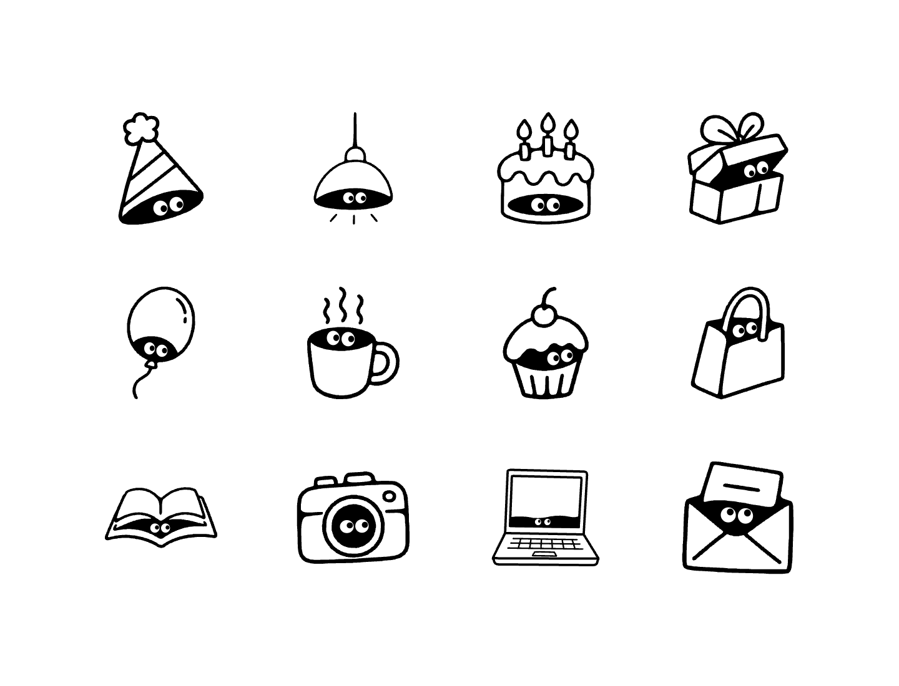

# Peepables

[English](#english) | [中文说明](#peepables-黑白偷看涂鸦) | [Live Demo 在线演示](https://jseanj.github.io/peepables/)

---

## English

**Little things. Curious eyes.**

**Live Demo:** [https://jseanj.github.io/peepables/](https://jseanj.github.io/peepables/)

Peepables creates black-and-white doodle widgets with a pair of eyes peeking from inside everyday objects. The pupils follow your cursor, blink naturally, and stay inside their eye whites.

A reusable Codex skill draws editable native SVG and packages it as a dependency-free Web Component. Drop one JavaScript file and one custom element into your page.



### Try the demo page

Open [`index.html`](index.html) (or [`examples/index.html`](examples/index.html)) locally in any browser. It showcases all 12 widgets in a clean, borderless, text-free layout where every item actively follows pointer movement and touch input.

To embed any single widget, copy its directory from `examples/` (or just `widget.js`) into your website and add:

```html
<script src="./party-hat-widget/widget.js" defer></script>
<peek-party-hat style="--peeking-size: 240px"></peek-party-hat>
```

Adjust the script path to match your website assets. Load the script once and reuse the element as many times as you like. No npm packages, frameworks, CDN, or runtime network requests are required.

### Included widgets

All 11 items from the reference sheet plus the laptop example:

| Item | Tag Name | Hidden In |
| --- | --- | --- |
| Party Hat | `<peek-party-hat>` | Opening under the brim |
| Hanging Lamp | `<peek-hanging-lamp>` | Underside of the lampshade |
| Birthday Cake | `<peek-birthday-cake>` | Slit in the lower tier |
| Gift Box | `<peek-gift-box>` | Gap between open lid and box |
| Balloon | `<peek-balloon>` | Dark bottom area of the balloon |
| Coffee Mug | `<peek-coffee-mug>` | Dark coffee surface inside rim |
| Cupcake | `<peek-cupcake>` | Opening under the swirl frosting |
| Shopping Bag | `<peek-shopping-bag>` | Top mouth opening of the bag |
| Open Book | `<peek-open-book>` | Dark space beneath the open pages |
| Camera | `<peek-camera>` | Dark aperture inside camera lens |
| Envelope | `<peek-envelope>` | Pocket opening behind the letter |
| Laptop | `<peek-laptop>` | Lower interior edge of the screen |

### Install the Codex skill

```bash
git clone https://github.com/jseanj/peepables.git
mkdir -p "$HOME/.codex/skills"
cp -R peepables/skills/peeking-eyes-doodle "$HOME/.codex/skills/"
```

Invoke it with a description of the object:

```text
Use $peeking-eyes-doodle to create a coffee mug widget.
Hide the eyes in the dark opening of the mug and make them follow the cursor.
Deliver the embeddable JavaScript, editable SVG, and a working demo page.
```

The skill references [assets/style-reference.png](skills/peeking-eyes-doodle/assets/style-reference.png) for line weight, eye proportions, and visual rhythm before drawing.

### Widget controls

| Attribute / style | Behavior |
| --- | --- |
| `style="--peeking-size: 160px"` | Set the widget width |
| `label="Eyes in a coffee mug"` | Set the accessible description |
| `blink="off"` | Disable random blinking |
| `idle-ms="3500"` | Opt into idle sleep after 3.5 seconds |
| `tracking="off"` | Stop tracking and center the pupils |

Widgets support responsive sizing, page scrolling, rotated artwork, multiple instances, and passive touch input. Reduced-motion preferences disable easing, automatic blinking, and idle sleep while retaining direct gaze tracking.

### Generate a widget from SVG

Use Python 3 to validate and package native SVG:

```bash
python3 skills/peeking-eyes-doodle/scripts/validate_svg.py --interactive \
  skills/peeking-eyes-doodle/assets/party-hat.svg

python3 skills/peeking-eyes-doodle/scripts/build_widget.py \
  skills/peeking-eyes-doodle/assets/party-hat.svg \
  --out output/party-hat-widget \
  --tag peek-party-hat \
  --label "Eyes peeking from a party hat"
```

### Browser checks

```bash
node skills/peeking-eyes-doodle/scripts/test_widget.mjs \
  examples/party-hat-widget/index.html
```

---

## Peepables · 黑白偷看涂鸦

**小物件，好奇的眼睛。**

**在线演示地址：** [https://jseanj.github.io/peepables/](https://jseanj.github.io/peepables/)

Peepables 是一套极简趣味的黑白手绘涂鸦网页小组件。每个日常物品暗处都藏着一双好奇的小眼睛，眼神随光标或触摸同向平滑移动，瞳孔在眼白内受物理约束自然回转，支持随机眨眼与闲置闭眼。

基于原生 SVG 与零依赖的 Web Component，只需引入一个 JS 文件和一个自定义元素标签，即可无缝嵌入任何网页。

### 体验全景演示页

在浏览器中直接打开根目录下的 [`index.html`](index.html)（或 [`examples/index.html`](examples/index.html)）。

演示页采用纯视觉排版，**不含任何文本干扰**，将参考图中的所有物品以网格自适应呈现。移动鼠标即可与页面上的全部小物件实时交互，感受视线同向跟随与眨眼的趣味效果。

### 接入你的网页

将所需组件目录（例如 `examples/coffee-mug-widget/`）内的 `widget.js` 复制到你的网站中，粘贴两行代码：

```html
<script src="./coffee-mug-widget/widget.js" defer></script>
<peek-coffee-mug style="--peeking-size: 200px"></peek-coffee-mug>
```

- 脚本只需加载一次，可在同页多次复用同一个标签。
- 零 npm 依赖、零外部字体、无需 CDN，背景透明，适配任意背景与布局。

### 完整收录组件清单

参考图中的 11 款萌趣物品以及笔记本电脑，均已独立打包交付：

| 物品 | 组件标签 | 藏身暗部位置 |
| --- | --- | --- |
| 派对帽 | `<peek-party-hat>` | 尖角帽底沿的黑色开口 |
| 吊灯 | `<peek-hanging-lamp>` | 吊灯罩内侧黑色空间（下方带发散光芒） |
| 生日蛋糕 | `<peek-birthday-cake>` | 蛋糕下层横向暗处缝隙（上方 3 支点燃蜡烛） |
| 礼物盒 | `<peek-gift-box>` | 半开盒盖下方的黑色盒体夹缝 |
| 气球 | `<peek-balloon>` | 气球底部内侧暗部（带高光与飘逸细线） |
| 咖啡杯 | `<peek-coffee-mug>` | 杯口黑色咖啡液面（上方带热气腾腾线条） |
| 纸杯蛋糕 | `<peek-cupcake>` | 顶层云朵糖霜下方的凹陷处（顶带樱桃） |
| 购物手提袋 | `<peek-shopping-bag>` | 纸袋顶部开口内侧（立体透视袋身） |
| 打开的书 | `<peek-open-book>` | 展开书页下方的拱形暗处隧道 |
| 复古相机 | `<peek-camera>` | 镜头圆环中央的黑色暗部 |
| 信封信件 | `<peek-envelope>` | 打开折叠信封口内侧（含露出的一纸信件） |
| 笔记本电脑 | `<peek-laptop>` | 打开屏幕内侧下缘暗部（含键盘与触控板） |

### 安装与使用 Codex 技能

你可以将本项目的生成技能安装到 Codex 中，生成任意新物品：

```bash
git clone https://github.com/jseanj/peepables.git
mkdir -p "$HOME/.codex/skills"
cp -R peepables/skills/peeking-eyes-doodle "$HOME/.codex/skills/"
```

在对话中用中文或英文描述物品需求即可：

```text
用 $peeking-eyes-doodle 生成一个咖啡杯网页组件，
眼睛藏在杯口并随鼠标移动，交付 JS、可编辑 SVG 和演示页。
```

### 组件属性与控制

所有组件均支持以下属性与样式配置，可在运行时动态更改：

| 属性 / 样式 | 说明 | 示例 |
| --- | --- | --- |
| `style="--peeking-size: 160px"` | 设置组件宽度（支持 `px`、`%`、`rem` 等） | `style="--peeking-size: 200px"` |
| `label="..."` | 设置无障碍读屏描述 | `label="藏在咖啡杯里的眼睛"` |
| `blink="off"` | 关闭默认的随机眨眼动画 | `blink="off"` |
| `idle-ms="3500"` | 开启闲置闭眼，指定鼠标静止毫秒数后闭眼（唤醒时自动睁开） | `idle-ms="3500"` |
| `tracking="off"` | 暂时关闭鼠标跟随，瞳孔居中回正 | `tracking="off"` |

- **触摸与滚动友好**：采用 Passive Pointer Events，完全不阻断移动端默认滑动手势与页面按钮点击。
- **性能与生命周期优化**：利用 `IntersectionObserver`，当元素滑出视口或标签页隐藏时自动停用动画循环与计时器；组件卸载时清理所有全局监听。
- **减弱动态效果支持**：遵循系统 `prefers-reduced-motion` 设置，关闭缓动追赶与眨眼，保留直接眼神注视。

### 从 SVG 校验与打包组件

如果你自己绘制了符合黑白规范的原生 SVG，可以使用内置脚本进行结构校验与自动打包：

```bash
# 1. 校验 SVG 规范（包括黑白单色、圆角轮廓、两组眼睛与标记）
python3 skills/peeking-eyes-doodle/scripts/validate_svg.py --interactive \
  skills/peeking-eyes-doodle/assets/coffee-mug.svg

# 2. 一键打包为独立 Web Component 组件目录
python3 skills/peeking-eyes-doodle/scripts/build_widget.py \
  skills/peeking-eyes-doodle/assets/coffee-mug.svg \
  --out output/coffee-mug-widget \
  --tag peek-coffee-mug \
  --label "藏在咖啡杯里的眼睛"
```

打包生成的目录包含：
- `widget.js`：打包完成的独立 Web Component，可直接引入网页。
- `artwork.svg`：原生可编辑矢量源文件。
- `embed.html`：现成嵌入代码片段。
- `index.html`：单组件演示与交互自检页。
- `INTEGRATION.md`：详细接入文档。

### 自动化浏览器测试

内置测试脚本基于原生 Node.js 与 Chrome DevTools Protocol 进行全自动无头交互验证：

```bash
node skills/peeking-eyes-doodle/scripts/test_widget.mjs \
  examples/coffee-mug-widget/index.html
```

覆盖左右跟随、瞳孔边界碰撞、缩放旋转、滚动响应、减少动态模式、闲置闭眼唤醒、组件卸载重挂载以及页面按钮互不干扰等 10 项核心检查。

### 项目目录结构

```text
peepables/
├── index.html                           # 根目录全景演示页（纯视觉无文字布局，包含全部 12 款组件）
├── preview.png                          # 全组件演示效果预览截图
├── README.md                            # 中英文项目文档
├── examples/
│   ├── index.html                       # 演示页备份与示例目录
│   ├── party-hat-widget/                # 派对帽组件（JS、SVG、独立 demo 与接入说明）
│   ├── hanging-lamp-widget/             # 吊灯组件
│   ├── birthday-cake-widget/            # 生日蛋糕组件
│   ├── gift-box-widget/                 # 礼物盒组件
│   ├── balloon-widget/                  # 气球组件
│   ├── coffee-mug-widget/               # 咖啡杯组件
│   ├── cupcake-widget/                  # 纸杯蛋糕组件
│   ├── shopping-bag-widget/             # 购物手提袋组件
│   ├── open-book-widget/                # 打开的书组件
│   ├── camera-widget/                   # 复古相机组件
│   ├── envelope-widget/                 # 信封信件组件
│   └── laptop-widget/                   # 笔记本电脑组件
└── skills/peeking-eyes-doodle/          # 可安装的 Codex 技能包
    ├── SKILL.md                         # 技能指导规范
    ├── assets/                          # 11 款 SVG 矢量源文件与参考图
    │   ├── style-reference.png          # 官方手绘贴纸参考图
    │   └── *.svg                        # 全部物品原生 SVG
    └── scripts/                         # 校验、打包与测试脚本工具
        ├── validate_svg.py              # SVG 规范校验器
        ├── build_widget.py              # Web Component 打包工具
        ├── render_svg.py                # 矢量转 PNG 预览工具
        └── test_widget.mjs              # 浏览器自动化测试脚本
```
